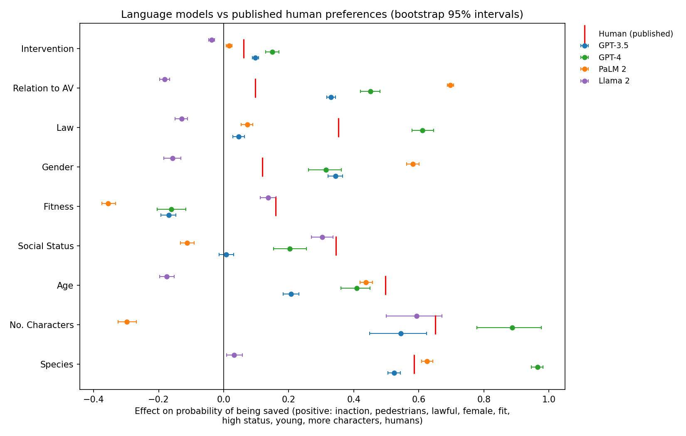
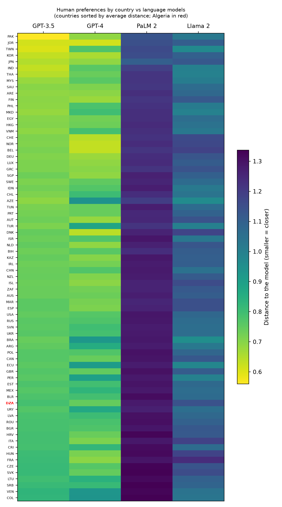
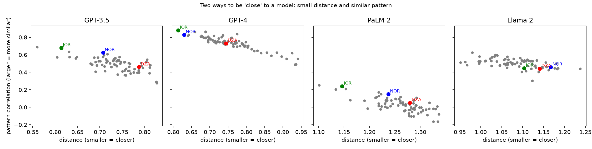

# Do language models weigh moral factors like humans do? A Moral Machine comparison by country

Statistics cannot say what is morally right. It can measure **what people prefer**, **how much each factor weighs in a decision**, and **how reliable that measurement is**. This project does that for the Moral Machine, the online experiment in which people choose whom a self-driving car should spare in an unavoidable crash, and compares four language models with human players from 74 countries.

> **This is a replication and extension, not a new idea.** Takemoto (2024) ran the Moral Machine on language models and compared them with humans. I reproduce his model estimates exactly and add my own estimates of human preferences **by country**, computed with the same method, with uncertainty measures, and robustness checks of the country comparison.

Nothing here says what the "right" choice is. The results describe the choices of volunteer players and of specific model versions.

## Main results

1. **Replication.** The nine effects for GPT-3.5, GPT-4, PaLM 2 and Llama 2 match the published values to four decimals (largest difference 0.000000).
2. **Human estimates.** With the same estimator, my global human effects (1.6 million players, first completed session of each) are within 0.012 of the published human values on all nine effects.
3. **The models are wrong in different ways, not just by different amounts.** GPT-3.5 and GPT-4 are the closest to humans on average, PaLM 2 is the farthest, and Llama 2 reverses several effects (for example Age). GPT-4 overshoots on Species and on sparing pedestrians; PaLM 2 does not prefer saving the larger group; GPT-3.5 treats social status as irrelevant.
4. **No clean "Western bias".** GPT-4 is close to Northern and Western Europe, but also to Jordan, Japan, Korea and Taiwan. The most consistent pattern is driven mostly by one factor, Species: **Latin American countries, Turkey and Azerbaijan** show a much weaker preference for sparing humans over pets (0.33 to 0.47, against 0.59 to 0.68 in the USA, Spain, Japan, Algeria, France, Germany and Jordan). As a result, Colombia, Venezuela, Peru, Ecuador and Brazil are among the farthest from GPT-3.5, GPT-4 and PaLM 2 and among the closest to Llama 2. Spain is typical, so this is not simply a language effect. This analysis does not explain the gap.
5. **Algeria** (about 930 players) looks like the world average on all nine effects, and its position in the country rankings is not distinctive under any of the robustness checks.

## Data

| Data | Source | Used for |
|---|---|---|
| Human Moral Machine responses (`SharedResponsesFullFirstSessions.csv`, 38 million rows, 1.62 million players) | Awad et al. (2018), *Nature* 563, 59-64, doi:10.1038/s41586-018-0637-6. [OSF | Moral Machine](https://osf.io/3hvt2/overview?view_only=4bb49492edee4a8eb1758552a362a2cf) | Main human estimates, by country |
| Language-model responses and published effects (`shared_responses_*.csv`, `summary_overall_preferences.csv`) | Takemoto (2024), Dryad doi:10.5061/dryad.d7wm37q6v; code at github.com/kztakemoto/mmllm | Model estimates, published human values |

**Raw data are not included in this repository** (size and licence terms). Check the licence on each download page before redistributing anything derived from them.

Facts that matter when reading the data:
- Each scenario is stored as two rows (one per side); a few scenarios have one or more than two rows.
- In the first-sessions file every player has exactly one session (1,622,019 players = 1,622,019 sessions).
- Long numeric IDs must be read as text. Opening and saving the files in Excel silently corrupts `UserID`.

## Method

**Effects.** I use the estimator in the authors' code (adapted from the supplementary code of Awad et al. 2018). Each effect is a weighted difference in the probability of being saved between two levels of a factor, on its own subset of scenarios, with weights equal to the inverse of the design probability of each scenario. Positive values mean sparing: inaction, pedestrians, the lawful, females, the fit, higher status, the young, more characters, humans.

**Number of characters.** For humans and models, I use the effect for 4 extra characters in the country comparisons. The published figure uses the difference with the largest effect, which is the 1-person difference for PaLM 2.

**Uncertainty.** Models: bootstrap over scenarios (500 draws), which captures sampling noise only, not prompt or version variation. Humans: cluster-robust standard errors with the player as the cluster.

**Closeness to a country.** Euclidean distance between the vector of nine effects of a model and that of a country, **corrected for noise** (small countries have noisier estimates, which would inflate their raw distance), with intervals from 2,000 simulated draws. Only countries with at least 300 players on every effect are ranked (74 countries).

**Robustness.** Rankings are recomputed (a) with the correlation between the nine effects (pattern only), (b) with each effect standardized by its variation across countries, and (c) dropping each effect in turn.

## Results

### Models vs published human values (bootstrap 95% intervals for models)

| Effect | GPT-3.5 | GPT-4 | PaLM 2 | Llama 2 | Human, published | Human, this project |
|---|---|---|---|---|---:|---:|
| Intervention | +0.098 [+0.088, +0.107] | +0.150 [+0.129, +0.170] | +0.017 [+0.008, +0.025] | -0.037 [-0.046, -0.028] | 0.061 | 0.058 |
| Relation to AV | +0.330 [+0.317, +0.344] | +0.452 [+0.421, +0.481] | +0.697 [+0.687, +0.707] | -0.182 [-0.197, -0.166] | 0.097 | 0.102 |
| Law | +0.046 [+0.029, +0.064] | +0.611 [+0.580, +0.645] | +0.073 [+0.053, +0.089] | -0.130 [-0.149, -0.111] | 0.353 | 0.360 |
| Gender | +0.344 [+0.321, +0.366] | +0.315 [+0.261, +0.362] | +0.581 [+0.563, +0.601] | -0.157 [-0.184, -0.132] | 0.119 | 0.124 |
| Fitness | -0.169 [-0.193, -0.147] | -0.161 [-0.204, -0.116] | -0.355 [-0.374, -0.333] | +0.137 [+0.112, +0.162] | 0.160 | 0.162 |
| Social Status | +0.007 [-0.015, +0.030] | +0.203 [+0.154, +0.254] | -0.113 [-0.133, -0.090] | +0.302 [+0.270, +0.336] | 0.345 | 0.356 |
| Age | +0.207 [+0.183, +0.231] | +0.409 [+0.361, +0.450] | +0.437 [+0.419, +0.458] | -0.176 [-0.198, -0.152] | 0.497 | 0.505 |
| No. Characters* | +0.545 [+0.448, +0.624] | +0.887 [+0.779, +0.976] | -0.298 [-0.325, -0.268] | +0.593 [+0.500, +0.671] | 0.651 | 0.663 |
| Species | +0.524 [+0.505, +0.543] | +0.965 [+0.946, +0.981] | +0.625 [+0.608, +0.644] | +0.032 [+0.009, +0.058] | 0.585 | 0.592 |

\*Model values use the published rule (difference with the largest effect); the human value of this project uses the 4-character difference.

| Model | Average absolute distance from published human values | Same direction as humans (of 9) |
|---|---:|---:|
| GPT-3.5 | 0.214 | 8 |
| GPT-4 | 0.229 | 8 |
| Llama 2 | 0.276 | 4 |
| PaLM 2 | 0.379 | 6 |



### Countries



- **GPT-3.5**: closest Pakistan, Taiwan, Jordan, Korea, India, Thailand, Japan, Malaysia; farthest Lithuania, Hungary, France, Serbia, Czechia, Slovakia, Colombia, Venezuela.
- **GPT-4**: closest Jordan, Norway, Belgium, Denmark, Switzerland, Korea, Germany, Finland; farthest Uruguay, Turkey, Peru, Ecuador, Brazil, Venezuela, Colombia, Azerbaijan.
- **PaLM 2**: closest Japan, Pakistan, Jordan, Korea, Taiwan, India, Azerbaijan, Saudi Arabia.
- **Llama 2**: closest Brazil, Azerbaijan, Taiwan, Ecuador, Thailand, North Macedonia, Peru, Turkey; farthest France, Italy, Belgium, Hungary, Denmark, Norway, Switzerland, Iceland.
- Differences between countries are small compared with the gap between any model and humans (for GPT-3.5 the distance ranges from 0.56 to 0.83 across countries, against 0.73 for the world average).

### Robustness

| Model | Rank agreement: pattern only | standardized | worst when dropping one effect |
|---|---:|---:|---:|
| GPT-3.5 | 0.63 | 0.95 | 0.88 |
| GPT-4 | 0.87 | 0.92 | 0.81 |
| PaLM 2 | 0.65 | 0.92 | 0.83 |
| Llama 2 | 0.53 | 0.81 | 0.61 (without Species) |

The Latin America pattern and the proximity of Jordan, Pakistan and Korea to the GPT models survive all variants. **Llama 2's country ranking is fragile**: it depends strongly on Species.



### Species effect (humans over pets) in selected countries

| Country | Effect | 95% interval | Players |
|---|---:|---|---:|
| Azerbaijan | 0.327 | [0.280, 0.374] | 1,108 |
| Colombia | 0.338 | [0.318, 0.358] | 6,810 |
| Brazil | 0.339 | [0.334, 0.344] | 105,102 |
| Venezuela | 0.347 | [0.315, 0.380] | 2,421 |
| Peru | 0.362 | [0.329, 0.396] | 2,389 |
| Ecuador | 0.375 | [0.329, 0.421] | 1,247 |
| Turkey | 0.387 | [0.380, 0.394] | 51,196 |
| Argentina | 0.392 | [0.377, 0.407] | 11,756 |
| Chile | 0.451 | [0.431, 0.470] | 6,411 |
| Mexico | 0.474 | [0.462, 0.487] | 15,307 |
| USA | 0.585 | [0.582, 0.587] | 337,035 |
| Spain | 0.620 | [0.613, 0.626] | 39,065 |
| Japan | 0.625 | [0.619, 0.632] | 43,822 |
| Algeria | 0.632 | [0.589, 0.675] | 927 |
| France | 0.659 | [0.655, 0.663] | 101,674 |
| Germany | 0.662 | [0.658, 0.666] | 103,238 |
| Jordan | 0.683 | [0.643, 0.723] | 1,019 |

### Algeria (about 930 players)

| Effect | Algeria | 95% interval | World |
|---|---:|---|---:|
| Species | 0.632 | [0.589, 0.675] | 0.592 |
| Age | 0.549 | [0.505, 0.593] | 0.505 |
| Law | 0.399 | [0.358, 0.440] | 0.360 |
| Social Status | 0.381 | [0.311, 0.452] | 0.356 |
| Fitness | 0.146 | [0.094, 0.199] | 0.162 |
| Gender | 0.101 | [0.051, 0.151] | 0.124 |
| Relation to AV | 0.081 | [0.043, 0.118] | 0.102 |
| Intervention | 0.015 | [-0.005, 0.036] | 0.058 |
| No. Characters (4 extra) | 0.636 | [0.560, 0.712] | 0.663 |

Algeria's differences from the world are small, and the intervals for Species and Age only just exclude the world value. No correction for multiple comparisons has been applied to this table.

## Limitations

- Players are volunteers on a website, not a representative sample of any country. A large sample reduces random noise, not selection bias.
- Each model is one version with one prompt wording. Intervals for models capture sampling noise over scenarios only.
- Model effects and country effects come from different designs (generated scenarios vs. real players), so distances describe similarity of preference patterns, not agreement on individual cases.
- Country effects are estimated from the first completed session of each player, not from all sessions.
- Conclusions are descriptive. This analysis does not say why countries differ or why a model behaves as it does, and it does not say what is right (the is-ought gap).
- Bigman & Gray (2020) argue that the missing "neutral" option in this design may inflate some preferences.

## Reproduce

```
pip install -r requirements.txt
python 01_explore_human_data.py --csv "SharedResponsesFullFirstSessions.csv" --out out_first   # CSV -> Parquet, structure, crude effects
python 03_llm_effects.py --data "mmllm_data/data" --out out_llm                                 # model effects (needs mm_estimators.py)
python 04_human_effects.py --parquet "out_first/SharedResponsesFullFirstSessions.parquet" --out out_human_first
python 05_models_vs_countries.py --human out_human_first --llm out_llm --out out_compare
python 06_robustness.py --human out_human_first --llm out_llm --out out_robust
```

`check_parquets.py` identifies what each Parquet file contains. `02_country_comparison.py` is an earlier exploratory comparison based on crude effects, kept for reference; its results are superseded by steps 04-06.

## Roadmap

- Repeat the human estimates on the full file (all sessions, `SharedResponses.csv`) as a second check.
- Formal country-versus-world tests with correction for multiple comparisons, using the final estimator.
- Use the survey file (`SharedResponsesSurvey.csv`) to compare demographic groups.
- Repeat the model analysis with other prompts and more recent model versions.

## References

- Awad, E. et al. (2018). The Moral Machine experiment. *Nature* 563, 59-64. doi:10.1038/s41586-018-0637-6
- Takemoto, K. (2024). The Moral Machine Experiment on Large Language Models. *Royal Society Open Science*. doi:10.1098/rsos.231393. Data: doi:10.5061/dryad.d7wm37q6v. Code: https://github.com/kztakemoto/mmllm
- Hainmueller, J., Hopkins, D. J., Yamamoto, T. (2014). Causal inference in conjoint analysis. *Political Analysis* 22, 1-30.
- Bigman, Y. E., Gray, K. (2020). Life and death decisions of autonomous vehicles. *Nature* 579, E1-E2.
